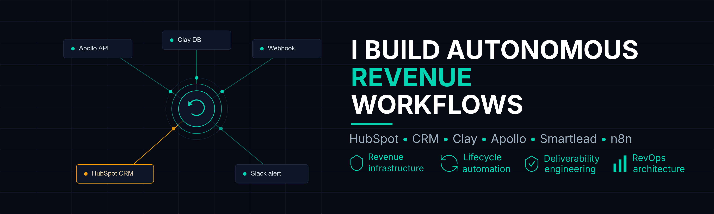

# Hi, I'm Erick Njuki 👋

## Go-To-Market Engineer | HubSpot CRM Architecture | RevOps Automation | GTM Systems

I design and optimize revenue infrastructure that connects CRM platforms, automation workflows, enrichment systems, outbound channels, and operational data into scalable growth systems.

My work focuses on helping teams eliminate fragmented marketing operations by building reliable systems across:

- CRM architecture
- Marketing automation
- Lead lifecycle management
- Data enrichment pipelines
- Outbound infrastructure
- Revenue operations workflows

I combine marketing operations expertise with an engineering mindset to create systems that are measurable, maintainable, and built for scale.

My implementation portfolio and technical documentation are available at **Portfolio**.

---

# What I Build

## CRM & Revenue Operations

- HubSpot CRM architecture and optimization
- Lifecycle stage and pipeline design
- CRM property governance
- Workflow automation
- Lead routing systems
- Revenue reporting infrastructure

## Data & Outbound Infrastructure

- Clay enrichment workflows
- Apollo prospecting systems
- Smartlead outbound infrastructure
- Data validation and enrichment pipelines
- B2B targeting and segmentation systems

## Automation & Integrations

- HubSpot workflow automation
- n8n and Zapier integrations
- API-based system connections
- Marketing operations automation
- GTM process optimization

---

# Technical Stack

## Revenue Operations

HubSpot • Clay • Smartlead • Apollo

## Automation

n8n • Zapier • Webhooks • API Integrations

## Web Infrastructure

WordPress • PHP • HTML • CSS • JavaScript  
Domains • DNS • Hosting • Landing Page Systems

---

## Social Links

[GitHub](https://github.com/ericknjuki) • [Twitter(X)](https://twitter.com/njukierick) • [Hashnode](https://hashnode.com/@SciptsBynjuki)

<!---
erickNjuki/erickNjuki is a ✨ special ✨ repository because its `README.md` (this file) appears on your GitHub profile.
You can click the Preview link to take a look at your changes.
--->
